# KLTN Social — Nền Tảng Mạng Xã Hội Microservices Backend

> **Đồ án Khóa Luận Tốt Nghiệp**  
> **Nền tảng:** Java 21, Spring Boot 3.4+, Spring Cloud, Apache Kafka, Redis, PostgreSQL 18 (pgvector)  
> **Kiến trúc:** Microservices Architecture, Clean Architecture (Vertical Slicing), Event-Driven Architecture, AI & Semantic Vector Search

---

## 1. Kiến Trúc Tổng Thể (System Architecture)

Hệ thống Backend được thiết kế theo mô hình **Microservices** phân tán, gồm **11 dịch vụ độc lập** và **1 thư viện dùng chung**, đăng ký và định tuyến tập trung thông qua Netflix Eureka và Spring Cloud Gateway.

```mermaid
graph TB
    subgraph ClientLayer ["Lớp Ứng Dụng (Client Layer)"]
        WebClient["Web Application (React + Vite + TypeScript)"]
        MobileClient["Mobile App (PWA / Mobile Client)"]
    end

    subgraph GatewayLayer ["Lớp Định Tuyến & Bảo Mật"]
        Eureka["Eureka Server (:8761)<br/>Service Discovery & Registry"]
        Gateway["API Gateway (:8080)<br/>Routing, JWT Verification, Rate Limiting"]
    end

    subgraph CoreServices ["Lớp Dịch Vụ Nghiệp Vụ (Microservices)"]
        AuthSvc["auth-service (:8081)<br/>Đăng ký, Đăng nhập, JWT, MFA"]
        PostSvc["post-service (:8082)<br/>Bài viết, Bình luận, Reaction, Semantic Search"]
        NotifSvc["notification-service (:8083)<br/>Thông báo đẩy, Push Notification, WebSocket"]
        MediaSvc["media-service (:8084)<br/>Upload ảnh, video, AWS S3 / MinIO"]
        UserSvc["user-service (:8085)<br/>Profile, Bạn bè, Nhóm, Gợi ý bạn bè"]
        CallSvc["call-service (:8086)<br/>WebRTC Audio/Video Signaling"]
        ChatSvc["chat-service (:8087)<br/>Chat 1-1, Chat nhóm, WebSocket STOMP"]
        FeedSvc["feed-service (:8088)<br/>Tổng hợp luồng tin (Timeline & Aggregation)"]
        AdminSvc["admin-service (:8090)<br/>Quản trị hệ thống, Kiểm duyệt báo cáo"]
        AiSvc["ai-service (:8091)<br/>Gemini Embedding, Auto Moderation, Tóm tắt AI"]
    end

    subgraph SharedFramework ["Lớp Dùng Chung"]
        Common["common-framework (JAR Library)<br/>Domain BaseEntity, ApiResponse, ErrorCode, JWT Utils, Mapper"]
    end

    subgraph DataLayer ["Lớp Lưu Trữ & Hạ Tầng (Infrastructure)"]
        Postgres[("PostgreSQL 18 + pgvector<br/>auth_db, post_db, user_db, ai_db")]
        RedisDB[("Redis 7<br/>Cache, Session, Feed Snapshot")]
        KafkaCluster[("Apache Kafka 3.7<br/>Event Streaming & Asynchronous Processing")]
        S3Storage[("AWS S3 / MinIO<br/>Object Storage (Media)")]
    end

    WebClient --> Gateway
    MobileClient --> Gateway
    Gateway --> Eureka
    Gateway --> CoreServices

    CoreServices --> Common
    CoreServices --> Postgres
    CoreServices --> RedisDB
    CoreServices --> KafkaCluster
    MediaSvc --> S3Storage
    PostSvc -.->|"Feign Client"| AiSvc
    UserSvc -.->|"Feign Client"| AiSvc
```



---

## 2. Danh Mục Microservices & Cổng Dịch Vụ (Service Catalog)

| STT | Tên Microservice | Port Chuẩn | Vai Trò & Chức Năng Chính | Công Nghệ & Storage |
|:---:|:---|:---:|:---|:---|
| **1** | **`eureka-server`** | `:8761` | Service Discovery & Registry, giám sát trạng thái sức khỏe (Heartbeat) của các dịch vụ. | Spring Cloud Netflix Eureka |
| **2** | **`api-gateway`** | `:8080` | Cổng vào API Gateway duy nhất, kiểm tra tính hợp lệ của JWT RS256, CORS và điều phối request. | Spring Cloud Gateway, Reactive Web |
| **3** | **`auth-service`** | `:8081` | Quản lý Đăng ký, Đăng nhập, cấp phát Access/Refresh Token (RSA256), xác thực 2 bước MFA TOTP. | PostgreSQL (`auth_db`), Redis, Kafka |
| **4** | **`post-service`** | `:8082` | Quản lý Bài viết, Reaction, Bình luận đa cấp, Tìm kiếm ngữ nghĩa (pgvector), Xếp hạng Bảng tin. | PostgreSQL (`post_db`), pgvector, Redis, Kafka |
| **5** | **`notification-service`**| `:8083` | Tiêu thụ Event từ Kafka và phát thông báo thời gian thực (Push Notification, WebSocket). | Redis, Spring WebSocket, Kafka |
| **6** | **`media-service`** | `:8084` | Xử lý upload/xóa ảnh, video, nén đa phương tiện, phát sinh Presigned URL lưu trữ S3/MinIO. | AWS S3 SDK, CloudFront, PostgreSQL |
| **7** | **`user-service`** | `:8085` | Quản lý Hồ sơ người dùng (Profile), Quan hệ bạn bè, Theo dõi, Quản lý Nhóm và Thành viên nhóm. | PostgreSQL (`user_db`), pgvector, Kafka |
| **8** | **`call-service`** | `:8086` | Thiết lập và điều phối tín hiệu WebRTC (Signaling SDP Offer/Answer/ICE Candidate) cho cuộc gọi thoại/video. | WebSocket STOMP, WebRTC Signaling |
| **9** | **`chat-service`** | `:8087` | Trò chuyện trực tiếp 1-1, trò chuyện nhóm thời gian thực, lưu trữ tin nhắn và trạng thái đã xem. | PostgreSQL / MongoDB, WebSocket STOMP |
| **10** | **`feed-service`** | `:8088` | Phân tán và tổng hợp dòng sự kiện Newsfeed theo thời gian thực (Timeline Aggregation). | Redis, Kafka |
| **11** | **`admin-service`** | `:8090` | Bảng điều khiển quản trị viên: Thống kê số liệu toàn hệ thống, xử lý khiếu nại báo cáo vi phạm, khóa tài khoản. | PostgreSQL, Redis, Spring Security RBAC |
| **12** | **`ai-service`** | `:8091` | Tích hợp Google Gemini: Tạo Vector Embedding 768 chiều, Kiểm duyệt nội dung tự động, Tóm tắt bài viết dài. | Google Gemini API, Spring Web, Feign |
| **-** | **`common-framework`**| *JAR* | Thư viện lõi chứa `BaseEntity`, `ApiResponse<T>`, `ErrorCode`, `BusinessException`, JWT Helper, Event Models. | Java Library Maven |

---

## 3. Định Tuyến API Gateway (Gateway Routing Table)

Tất cả các yêu cầu từ Frontend đều được gửi tới `http://localhost:8080`:

| Endpoint Prefix | Microservice Đích | Port Đích | Chức Năng |
|:---|:---|:---:|:---|
| `/api/v1/auth/**` | `auth-service` | `:8081` | Đăng ký, đăng nhập, refresh token, xác thực MFA |
| `/api/v1/posts/**` | `post-service` | `:8082` | Đăng bài, newsfeed, tương tác, tìm kiếm hybrid |
| `/api/v1/notifications/**`| `notification-service` | `:8083` | Đọc thông báo, cấu hình thông báo |
| `/api/v1/media/**` | `media-service` | `:8084` | Upload và quản lý tệp đa phương tiện |
| `/api/v1/users/**` | `user-service` | `:8085` | Hồ sơ người dùng, kết bạn, theo dõi |
| `/api/v1/groups/**` | `user-service` | `:8085` | Tạo nhóm, tham gia nhóm, duyệt thành viên |
| `/api/v1/calls/**` | `call-service` | `:8086` | Khởi tạo phòng gọi thoại/video |
| `/api/v1/chat/**` | `chat-service` | `:8087` | Lấy lịch sử chat, gửi tin nhắn REST |
| `/api/v1/feeds/**` | `feed-service` | `:8088` | Lấy luồng sự kiện phân tán |
| `/api/v1/admin/**` | `admin-service` | `:8090` | Thống kê và quản trị tài khoản |
| `/api/v1/moderation/**` | `admin-service` | `:8090` | Xử lý vi phạm, xử lý kháng cáo |
| `/api/v1/ai/**` | `ai-service` | `:8091` | Tạo embedding, kiểm duyệt văn bản AI |
| `/ws/**` | `chat / notif / call` | Nhiều port | WebSocket STOMP kết nối thời gian thực |

---

## 4. Kiến Trúc Clean Architecture & Vertical Slicing

Mỗi Microservice đều tuân thủ nguyên lý **Clean Architecture** kết hợp mô hình phân chia theo tính năng (**Vertical Slicing**):

```
module-service/
├── domain/                  → Entities thuần túy (POJO), Value Objects, Enums, Repository Interfaces
│   ├── entities/
│   ├── enums/
│   └── repository/
├── application/             → Features logic (CQRS), DTOs, Mappers, Services
│   ├── features/
│   │   └── {feature_name}/
│   │       ├── commands/    → {Action}Command, {Action}CommandHandler, {Action}Response
│   │       └── queries/     → {Action}Query, {Action}QueryHandler, {Action}Response
│   ├── mapper/              → MapStruct interface chuyển đổi DTO ↔ Domain
│   └── service/             → Các domain service phức hợp (vd: FeedRankingService, PostEmbeddingService)
├── infrastructure/          → Triển khai kỹ thuật cụ thể (Spring Data JPA, Redis Cache, Security, Client)
│   ├── client/              → OpenFeign Client giao tiếp liên service (AiServiceClient, ...)
│   ├── persistence/         → JPA DbModels, JPA Repositories, Schema Synchronizer
│   └── security/            → Cấu hình xác thực phân quyền SecurityFilterChain
└── presentation/            → REST API Controllers, Request/Response Payload
    └── controller/v1/       → PostController, AuthController, UserController,...
```

---

## 5. Điểm Nổi Bật Về Trí Tuệ Nhân Tạo & Vector Embedding

Dự án ứng dụng mô hình trí tuệ nhân tạo hiện đại giải quyết bài toán cốt lõi của mạng xã hội:

1. **Semantic Search (Tìm kiếm ngữ nghĩa thông minh):** Sử dụng Google Gemini `text-embedding-004` chuyển đổi văn bản bài viết thành vector 768 chiều. Lưu trữ và truy vấn tương đồng Cosine Similarity trên PostgreSQL 18 thông qua chỉ mục **HNSW (Hierarchical Navigable Small World)**.
2. **Hybrid Search Blending:** Kết hợp tìm kiếm từ khóa chính xác (Keyword Full-text Search) với tìm kiếm ngữ nghĩa sâu (Semantic Vector Search), giúp tìm thấy bài viết ngay cả khi người dùng không gõ đúng từ ngữ chính xác.
3. **News Feed Multi-Factor Ranking:** Bảng tin được xếp hạng bằng công thức tối ưu kết hợp: Điểm tương tác (Logarithmic Engagement), Độ tươi mới bài viết (Exponential Half-life Decay 36h) và Điểm thân thiết xã hội (Social Affinity).
4. **Search-Biased Intent Retargeting:** Hệ thống tự động ghi nhận ý định tìm kiếm gần nhất của người dùng. Khi người dùng quay lại Bảng tin, các bài viết có chủ đề tương đồng sẽ được AI boost điểm thưởng và hiển thị kèm huy hiệu giải thích trực quan: `✨ Gợi ý theo chủ đề bạn vừa tìm: [chủ đề]`.
5. **Friend & Group Semantic Recommendation:** Gợi ý kết bạn và gợi ý nhóm dựa trên khoảng cách ngữ nghĩa giữa hồ sơ quan tâm cá nhân và thông tin cộng đồng.

> [!TIP]
> Chi tiết toàn diện về công thức toán học, cấu trúc chỉ mục HNSW và mã nguồn thuật toán xem tại:  
> 📄 **[Tài Liệu Kỹ Thuật: Vector Embedding & Thuật Toán Đề Xuất (EMBEDDING_AND_RECOMMENDATION_ALGORITHMS.md)](file:///e:/KhoaLuan/khoaLuanTotNghiep_MXH_BE/EMBEDDING_AND_RECOMMENDATION_ALGORITHMS.md)**

---

## 6. Hướng Dẫn Thiết Lập & Khởi Chạy (Getting Started)

### 6.1. Yêu Cầu Môi Trường (Prerequisites)
- **Java Development Kit (JDK):** Phiên bản **Java 21 LTS**
- **Apache Maven:** Phiên bản **3.9+**
- **Cơ sở dữ liệu:** PostgreSQL 18.x đã cài đặt extension **`pgvector 0.8.7`**
- **Bộ đệm & Lưu trữ:** Redis 7.x
- **Event Streaming:** Apache Kafka 3.7+

### 6.2. Thiết Lập Cơ Sở Dữ Liệu
Tạo các database cần thiết trên PostgreSQL:
```sql
CREATE DATABASE auth_db;
CREATE DATABASE post_db;
CREATE DATABASE user_db;
CREATE DATABASE ai_db;
CREATE DATABASE admin_db;

-- Kích hoạt extension pgvector trên các db nghiệp vụ
\c post_db;
CREATE EXTENSION IF NOT EXISTS vector;

\c user_db;
CREATE EXTENSION IF NOT EXISTS vector;
```

### 6.3. Biên Dịch Dự Án
Chạy lệnh Maven tại thư mục gốc backend:
```bash
# Biên dịch thư viện chung trước
cd common-framework && mvn clean install -DskipTests && cd ..

# Biên dịch toàn bộ các Microservices
mvn clean compile -DskipTests
```

### 6.4. Khởi Chạy Hệ Thống
Khởi chạy các service theo đúng thứ tự phụ thuộc (bằng IntelliJ IDEA hoặc terminal):
1. **`eureka-server`** (Port `:8761`) — Chờ đăng ký sẵn sàng.
2. **`auth-service`** (Port `:8081`), **`ai-service`** (Port `:8091`).
3. **`user-service`** (Port `:8085`), **`post-service`** (Port `:8082`), **`media-service`** (Port `:8084`).
4. **`notification-service`** (Port `:8083`), **`chat-service`** (Port `:8087`), **`call-service`** (Port `:8086`), **`admin-service`** (Port `:8090`).
5. **`api-gateway`** (Port `:8080`) — Cổng giao tiếp chính cho Frontend.

---

## 7. Quy Chuẩn Phát Triển & Tiêu Chuẩn Mã Nguồn

- **Lombok:** Áp dụng `@FieldDefaults(level = AccessLevel.PRIVATE)` cho đóng gói dữ liệu và `@RequiredArgsConstructor` cho Dependency Injection qua Constructor.
- **Validation:** Chuẩn Jakarta Validation (`@Valid`, `@NotNull`, `@NotBlank`) kết nối file thông báo lỗi đa ngôn ngữ `ValidationMessages.properties`.
- **Phân trang & Lọc:** Chuẩn hóa thông qua `BaseFilter` và `PagedResponse<T>` đồng nhất giữa các service.
- **Soft Delete & Audit:** Mọi thực thể nghiệp vụ kế thừa `BaseEntity` lưu vết `createdAt`, `updatedAt`, `deleted`.
- **Tài liệu API:** Chuẩn OpenAPI 3.0 (Swagger UI) tích hợp trên từng service tại `/swagger-ui.html`.
